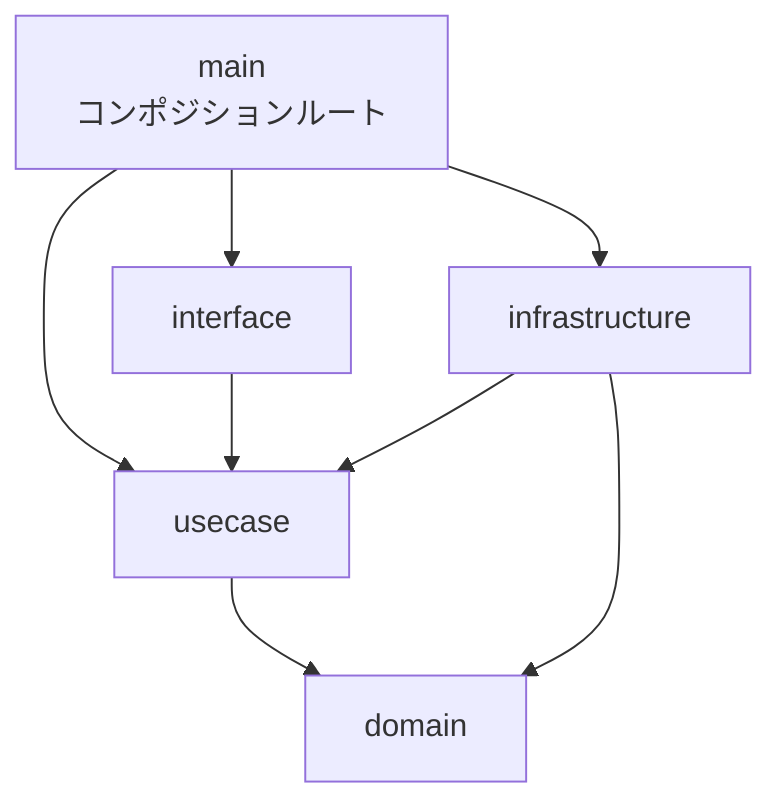

## はじめに

ここまでの章で「interface は利用側で定義する」「実装は infrastructure 層に置く」「依存の注入は main 関数で行う」と繰り返し書いてきました。この章では最後の「main 関数で注入する」の部分を掘り下げます。依存の配線をどこに書くか、手動で書くかツールに任せるか、という論点です。

先に私の結論を書いておきます。**手動 DI から始めてください**。Go の DI はコンストラクタ関数に引数を渡すだけの話で、ツールが必要になるのは配線が数百行を超えてからです。

---

## コンポジションルートという考え方

依存性注入の文献でよく参照される Mark Seemann は、依存を組み立てる場所をコンポジションルートと呼び、こう定義しています。

> A Composition Root is a (preferably) unique location in an application where modules are composed together.
>
> — Mark Seemann, [Composition Root](https://blog.ploeh.dk/2011/07/28/CompositionRoot/)（2011）

重要なのは、この場所がアプリケーション内で唯一であることです。配線がハンドラの中や UseCase 層の中に散らばると、どの実装がどこで使われているかを追えなくなります。Go のアプリケーションでは、コンポジションルートは`main`パッケージ、もしくは`main`から呼ばれる初期化専用のパッケージになります。

コンポジションルートには特権があります。ここだけは、すべてのレイヤーを import してよいのです。domain 層から infrastructure 層まで、すべてを知らなければ配線できないからです。依存性ルールの例外ではなく、最も外側のレイヤーだからこそ許される役割です。



---

## 手動 DI：まずはこれで十分

手動 DI の実体は、コンストラクタ関数の呼び出しを依存の順に並べることです。

```go
// cmd/server/main.go。コンストラクタなどの詳細は省略しています。
func run() error {
    db, err := sql.Open("pgx", os.Getenv("DATABASE_URL"))
    if err != nil {
        return err
    }
    defer db.Close()

    // infrastructure層：外側から組み立てる
    orderRepo := postgres.NewOrderRepository(db)
    mailer := smtp.NewMailer(os.Getenv("SMTP_HOST"))

    // usecase層：infrastructureの実装を注入する
    createOrder := usecase.NewCreateOrderInteractor(orderRepo, mailer)
    getOrder := usecase.NewGetOrderInteractor(orderRepo)

    // interface層：Interactorを注入する
    orderHandler := handler.NewOrderHandler(createOrder, getOrder)

    mux := http.NewServeMux()
    mux.HandleFunc("POST /orders", orderHandler.Create)
    mux.HandleFunc("GET /orders/{id}", orderHandler.Get)

    return http.ListenAndServe(":8080", mux)
}

func main() {
    if err := run(); err != nil {
        log.Print(err)
        os.Exit(1)
    }
}
```

`run` が戻ってから終了コードを設定するため、`defer db.Close()` が実行されます。実際のサービスでは、後述するように受付停止と進行中の処理の完了も待ちます。

利点は3つあります。

- **コンパイル時にすべて検証される**。引数の型が合わなければビルドが通りません
- **実行順が読める**。何がどの順で初期化されるか、上から読むだけで分かります
- **学習コストがゼロ**。新しくチームに入った人が追加のツールを学ぶ必要がありません

### interface 満足の検証もここに置く

第12章「Go の interface 設計」で紹介した`var _`イディオムの置き場所の一例が、コンポジションルートです。

```go
// cmd/server/main.go
var (
    _ usecase.OrderRepository = (*postgres.OrderRepository)(nil)
    _ usecase.Mailer          = (*smtp.Mailer)(nil)
)
```

infrastructure 層のテストファイルに書く方法もありますが、私はコンポジションルートに集約する方を選びます。「この実装はこの interface として使われる」という配線の宣言そのものだからです。

### 肥大化への対策：モジュールごとの組み立て関数

モジュールが増えると`main`が長くなります。その場合は、モジュールごとに組み立て関数を切り出します。

```go
// internal/order/di/provider.go
package di

func NewOrderHandler(db *sql.DB, mailer usecase.Mailer) *handler.OrderHandler {
    repo := postgres.NewOrderRepository(db)
    create := usecase.NewCreateOrderInteractor(repo, mailer)
    get := usecase.NewGetOrderInteractor(repo)
    return handler.NewOrderHandler(create, get)
}
```

```go
// cmd/server/main.go
orderHandler := orderdi.NewOrderHandler(db, mailer)
userHandler := userdi.NewUserHandler(db)
```

`main`はモジュールをまたぐ資源（DB 接続、設定、ロガー）の生成と、モジュール組み立て関数の呼び出しだけになります。この形なら、モジュールが10個あっても`main`は数十行に収まります。

---

## logger、tracer、Worker の配線と停止

DB と同様に、`slog.Logger` と OpenTelemetry の tracer provider は外側で設定します。各コンストラクタに必要な logger や tracer を渡し、Domain Entity には渡しません。たとえば、次のように配線します。

```go
logger := slog.New(slog.NewJSONHandler(os.Stdout, nil))
// 設定済みの tracer provider は exporter とともに起動時に生成します。
tracer := tracerProvider.Tracer("book-service")
repo := postgres.NewBookRepository(db)
lookup := usecase.NewLookupBook(repo, tracer)
handler := httpadapter.NewBookHandler(lookup, logger)
worker := jobs.NewWorker(repo, logger, tracer)
```

この断片では provider の設定とコンストラクタの実装を省略しています。Worker の開始・停止と待ち合わせもコンポジションルートの責任です。リクエストに紐づく goroutine と Worker の寿命の違いは第18章、計装の粒度は第20章で扱います。

終了シグナルを受けたら、新しい受付を止め、進行中の HTTP 処理を drain します。HTTP 処理が Worker に依存する場合は、その後に Worker をキャンセルして完了を待ちます。最後に DB を閉じ、テレメトリーを flush して provider を停止します。次の例は、アプリケーションが追跡するすべてのハンドラの完了を `handlersDone`、Worker の完了を `workerDone` のクローズで知らせる構成です。

```go
func stop(
    server *http.Server,
    handlersDone <-chan struct{},
    cancelWorker context.CancelFunc,
    workerDone <-chan struct{},
    db *sql.DB,
    shutdownTelemetry func(context.Context) error,
) error {
    ctx, cancel := context.WithTimeout(context.Background(), 10*time.Second)
    defer cancel()

    var errs []error
    if err := server.Shutdown(ctx); err != nil {
        errs = append(errs, err)
        if err := server.Close(); err != nil {
            errs = append(errs, err)
        }
    }
    select {
    case <-handlersDone:
    case <-ctx.Done():
        cancelWorker()
        return errors.Join(append(errs, ctx.Err())...)
    }
    cancelWorker()
    select {
    case <-workerDone:
    case <-ctx.Done():
        // 使用中の資源を閉じず、呼び出し側で強制終了を判断します。
        return errors.Join(append(errs, ctx.Err())...)
    }
    if err := db.Close(); err != nil {
        errs = append(errs, err)
    }
    if err := shutdownTelemetry(ctx); err != nil {
        errs = append(errs, err)
    }
    return errors.Join(errs...)
}
```

シグナルの Context はすでにキャンセルされているため、終了処理には独立した期限を使います。ハンドラの追跡は別途実装し、受付停止後に新しいハンドラが追加されないことを保証します。ハイジャックした接続も別途管理します。この例の `shutdownTelemetry` は provider の shutdown を呼ぶ関数です。複数 provider があればそれぞれ停止します。期限を共有するため HTTP の drain が長引くと、送信時間を確保できないことがあります。運用に応じて段階ごとの時間を確保し、停止失敗を報告します。`db.Close` 自体は Context による期限を受け取らないため、残りの終了猶予も考慮します。ハンドラや Worker が停止しない場合は資源を使用中のまま閉じず、終了猶予と強制終了の方針に従います。

---

## wire：コード生成による自動配線

[google/wire](https://github.com/google/wire)は、コンストラクタ関数の集合から配線コードを生成するツールです。

```go
// internal/order/di/wire.go
//go:build wireinject

package di

func InitializeOrderHandler(db *sql.DB) *handler.OrderHandler {
    wire.Build(
        postgres.NewOrderRepository,
        wire.Bind(new(usecase.OrderRepository), new(*postgres.OrderRepository)),
        usecase.NewCreateOrderInteractor,
        usecase.NewGetOrderInteractor,
        handler.NewOrderHandler,
    )
    return nil // wireが実装を生成する
}
```

`wire`コマンドを実行すると、手動 DI で書くのと同等のコードが`wire_gen.go`として生成されます。生成されるのは普通の Go コードなので、実行時のリフレクションはなく、型の不整合はコンパイルエラーになります。

注意点は、`wire.Bind`の行数です。interface と実装の対応を1つずつ宣言する必要があるため、interface を利用側で細かく定義する本書のスタイルとはやや相性が悪く、Bind の記述が積み上がります。コンストラクタが増えたときの追記がプロバイダ集合への1行で済む点が、手動 DI に対する主な利点です。

---

## dig / fx：リフレクションによる DI コンテナ

[uber-go/dig](https://github.com/uber-go/dig)は実行時にリフレクションで依存を解決するコンテナで、[uber-go/fx](https://github.com/uber-go/fx)はその上に構築されたアプリケーションフレームワークです。

```go
c := dig.New()
c.Provide(postgres.NewOrderRepository)
c.Provide(usecase.NewCreateOrderInteractor)
c.Provide(handler.NewOrderHandler)

err := c.Invoke(func(h *handler.OrderHandler) {
    // hを使ってサーバーを起動する
})
```

登録順を気にしなくてよい手軽さはありますが、配線ミスがコンパイルエラーではなく実行時エラーになります。依存の解決に失敗するとアプリケーションが起動時に落ちる、という形で発覚します。コンパイル時検証を手放すこの性質を、私は受け入れていません。大規模なコードベースで fx を全面採用しているチームなら話は別ですが、これから設計を始めるプロジェクトで最初に選ぶものではないと考えています。

---

## 3つのアプローチの比較

| 観点           | 手動 DI                  | wire                     | dig / fx               |
| -------------- | ------------------------ | ------------------------ | ---------------------- |
| 検証タイミング | コンパイル時             | コンパイル時（生成時）   | 実行時                 |
| 追加ツール     | 不要                     | wire コマンド            | ライブラリ             |
| 配線の可読性   | 高い（ただの Go コード） | 生成コードを読めば分かる | コンテナ内部は追えない |
| 配線追加の手間 | 引数の手直しが必要       | プロバイダ登録のみ       | プロバイダ登録のみ     |
| 向く規模       | 小〜中                   | 中〜大                   | fx 前提の大規模組織    |

移行の順序も書いておきます。手動 DI で始めて、モジュール組み立て関数で整理して、それでも配線の修正が開発の待ち時間になってきたら wire を検討する。この順です。逆方向の移行（wire をやめて手動に戻す）は生成コードをコミットすれば済むので、wire の採用はやり直しがききます。

---

## まとめ

- 依存の配線はコンポジションルート（`main`か初期化専用パッケージ）に集約します。配線と interface 満足の検証をここに置けば、実装の差し替え地点が1箇所になります
- 手動 DI から始めます。コンパイル時検証、可読性、学習コストのバランスが最もよいからです
- 肥大化にはまずモジュールごとの組み立て関数で対処し、それでも足りなければ wire を導入します
- 実行時解決の DI コンテナは、コンパイル時検証を手放すコストに見合う理由があるときだけ選びます
- logger、tracer、Worker の寿命も外側で管理し、利用者の停止を待ってから共有資源を閉じます

---

## 参考文献

| 内容 | 出典 |
| --- | --- |
| Composition Root | Mark Seemann, [Composition Root](https://blog.ploeh.dk/2011/07/28/CompositionRoot/)（2011） |
| wire | [google/wire - GitHub](https://github.com/google/wire) |
| wire 紹介記事 | The Go Blog, [Compile-time Dependency Injection With Go Cloud's Wire](https://go.dev/blog/wire) |
| dig | [uber-go/dig - GitHub](https://github.com/uber-go/dig) |
| fx | [uber-go/fx - GitHub](https://github.com/uber-go/fx) |
