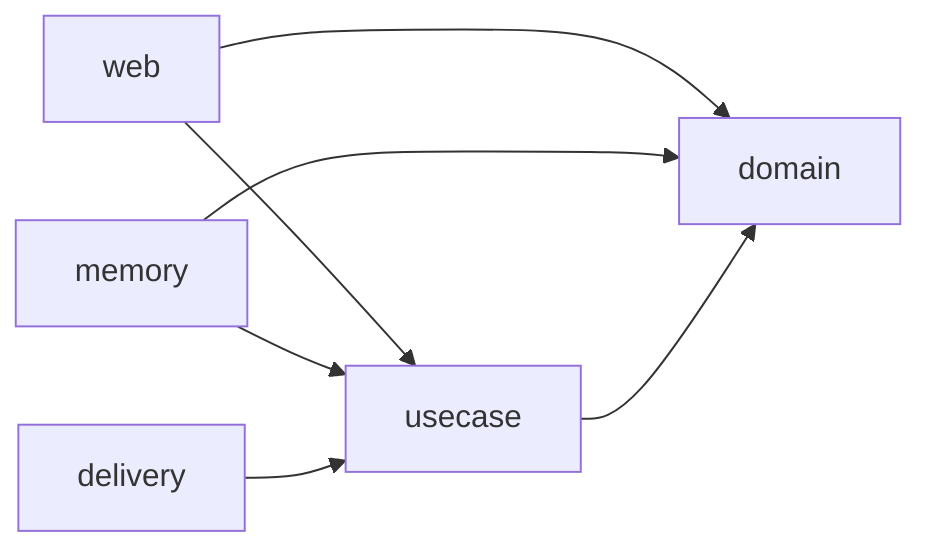

## はじめに

第3章では、依存性ルールを「依存の矢印を内側に向ける」ことと説明しました。ただし、図に描いてチームで合意しただけでは、ルールは守られ続けません。本章では、その理由と、ルールをコードで検査する最小の方法を扱います。検査は、Go の静的解析で書きます。解析器は、本書のために作った [depcheck](https://github.com/135yshr/depcheck) として公開しています。継続的な実行や例外の運用は、第22章で扱います。

## なぜ検査が必要なのか

Go のコンパイラは、パッケージ間の import 循環を拒否します。`domain` と `web` が互いに import していれば、ビルドは通りません。

ところが、`web` が `domain` を import していない状態で、`domain` が `web` を import した場合は、循環が生じません。コンパイラはこの import を拒否しません。つまり、依存性ルールに違反する一方向の import は、コンパイラには止められません。

コードレビューで見つける方法もあります。しかし、import の1行は、大きな変更の中では見落とされやすくなります。違反は少しずつ増えるため、気づいたときには、取り除く範囲が広がっています。必要なのは、違反を機械が、書いた直後に知らせる仕組みです。

## なぜ import を調べるのか

依存性ルールが禁じるのは、内側のパッケージが外側のパッケージを「知る」ことです。Go では、別のパッケージの識別子を使うために、そのパッケージを import 宣言に書く必要があります。Go 言語仕様は、import 宣言を、宣言を含むソースファイルが、import したパッケージの機能に依存することを示すものと説明しています。

つまり、import 宣言は、ソースコードに現れる依存の関係そのものです。依存の向きは、import 宣言を調べれば確かめられます。

ただし、import から分かるのは「依存がある」ことだけです。その依存が設計として適切かどうかは、import だけでは分かりません。本章の検査は、「この向きの依存は作らない」と決めた禁止の関係に絞ります。

## 検査に求めること

検査の価値は、違反を見つけることよりも、違反した人が直せることにあります。報告には、次の3点を含めます。

- どこで: ファイルと行です。エディタや CI から、その場所へ移動できます。
- 何が: import した側のパッケージと、された側のパッケージです。
- なぜ、どう直すか: どのルールに反するのかと、直す向きです。

「`domain` が `web` を import している」とだけ表示されても、読んだ人は、なぜいけないのかを調べるところから始めます。そうなると、検査は無視されやすくなります。理由と直す向きを添えます。本書では、第3章の考え方に沿って、「必要な振る舞いを内側の interface で表し、外側が実装する」と案内します。

## Go の静的解析で書く

Go には、プログラムを実行せずにソースコードを調べる枠組みとして、`golang.org/x/tools/go/analysis` があります。`go vet` も、この枠組みの解析器の集まりです。解析器（Analyzer）を1つ書くと、`go vet` と同じ形式で結果を表示でき、エディタや CI にそのまま組み込めます。

`go list` の出力をシェルスクリプトで加工する方法でも、import の関係は取り出せます。ただし、出力の書式に依存し、違反の位置を import の行として示せず、検査自体のテストも書きにくくなります。`go/analysis` を使うと、次のことができます。

- 解析器が、構文木とパッケージの情報を受け取る
- 違反を、import の行の位置に報告する
- 解析器を、テストデータに対して自動で試す

## 最小の解析器

最初に、禁止の組を表す型を決めます。

```go
// Rule は禁止する依存の1つの組です。
type Rule struct {
    // From は、import する側のパッケージです。子のパッケージも対象です。
    From string
    // Deny は、From が import してはならないパッケージです。子のパッケージも対象です。
    Deny []string
    // Reason は、なぜ禁止するのかと、直す向きです。違反の報告にそのまま添えます。
    Reason string
}

// 実際の depcheck では、各項目に `json:"from"` のようなタグを付け、ルールファイルから読みます。
```

解析器は、パッケージごとに呼ばれます。対象のパッケージが `From` に当てはまるときだけ、各ファイルの import 宣言を調べ、禁止の対象なら報告します。

```go
func New(rules []Rule) *analysis.Analyzer {
    return &analysis.Analyzer{
        Name: "depcheck",
        Doc:  "report imports that go against the forbidden dependency directions",
        Run: func(pass *analysis.Pass) (any, error) {
            return nil, run(pass, rules)
        },
    }
}

func run(pass *analysis.Pass, rules []Rule) error {
    // 外部テストのパッケージ（foo_test）も、foo と同じ層として扱います。
    self := strings.TrimSuffix(pass.Pkg.Path(), "_test")
    for _, rule := range rules {
        if !under(self, rule.From) {
            continue
        }
        for _, file := range pass.Files {
            for _, spec := range file.Imports {
                path, err := strconv.Unquote(spec.Path.Value)
                if err != nil {
                    return fmt.Errorf("cannot read the import path: %w", err)
                }
                for _, deny := range rule.Deny {
                    if under(path, deny) {
                        pass.Reportf(spec.Pos(), "%s must not import %s: %s", self, path, rule.Reason)
                    }
                }
            }
        }
    }
    return nil
}

// under は、path が root か、root の子のパッケージかを返します。
func under(path, root string) bool {
    return path == root || strings.HasPrefix(path, root+"/")
}
```

要点は3つです。

- `pass.Files` の `file.Imports` が、各ファイルの import 宣言です。
- `pass.Reportf` に import の位置（`spec.Pos()`）を渡すと、違反が import の行に表示されます。
- `under` は、文字列の前方一致ではなく、パスの区切りで比べます。`web` を禁止しても、名前が似ているだけの `webextra` は対象になりません。

このコードは、depcheck の [`depcheck.go`](https://github.com/135yshr/depcheck/blob/v0.1.1/depcheck.go) を、説明用に簡略化したものです。報告の文は、実際の出力と同じ形です。

## 規則を書く

読書ログサービスは、第5章と第23章でも使う共通の題材です。サンプルコードは、リポジトリ [go-service-design-examples](https://github.com/135yshr/go-service-design-examples) の `booklog` にあります。パッケージの依存は、次の向きです。矢印は import を表します。



内側の `domain` と `usecase` が、外側を import しないことを規則にします。depcheck は、規則をモジュールのルートの `.depcheck.json` から読みます。`booklog/.depcheck.json` の内容は、次のとおりです。

```json
{
  "rules": [
    {
      "from": "github.com/135yshr/go-service-design-examples/booklog/domain",
      "deny": [
        "github.com/135yshr/go-service-design-examples/booklog/usecase",
        "github.com/135yshr/go-service-design-examples/booklog/memory",
        "github.com/135yshr/go-service-design-examples/booklog/delivery",
        "github.com/135yshr/go-service-design-examples/booklog/web",
        "github.com/135yshr/go-service-design-examples/booklog/cmd",
        "context",
        "database/sql",
        "log/slog",
        "net/http"
      ],
      "reason": "domain は業務のルールだけを持ち、外側と、通信・保存・ログの仕組みを知りません。必要な振る舞いは domain 側の interface で表し、外側が実装します"
    },
    {
      "from": "github.com/135yshr/go-service-design-examples/booklog/usecase",
      "deny": [
        "github.com/135yshr/go-service-design-examples/booklog/memory",
        "github.com/135yshr/go-service-design-examples/booklog/delivery",
        "github.com/135yshr/go-service-design-examples/booklog/web",
        "github.com/135yshr/go-service-design-examples/booklog/cmd"
      ],
      "reason": "usecase は保存や HTTP の実装を知りません。必要な操作は usecase 側の interface で表し、外側が実装します"
    }
  ]
}
```

`deny` には、標準パッケージも書けます。`domain` から、`net/http` や `database/sql` を締め出すこともできます。

最初から、すべての層の関係を網羅する必要はありません。守りたい境界を1つか2つ選び、違反したときに理由と直す向きが分かる検査を用意します。

ルールファイルが見つからない場合や、項目の書き間違い（未知の項目、空の `reason` など）がある場合、depcheck は失敗します。書き間違いで検査が静かに働かなくなり、「違反がない」と見分けられなくなることを防ぐためです。

## 実行する

depcheck は、`go vet` の `-vettool` として使えるコマンドです。インストールして、検査したいモジュールで実行します。

```bash
go install github.com/135yshr/depcheck/cmd/depcheck@v0.1.1
git clone https://github.com/135yshr/go-service-design-examples.git
cd go-service-design-examples/booklog
go vet -vettool=$(which depcheck) ./...
```

違反がなければ、何も表示されずに終わります。たとえば、`domain` が、`web` の下にあるパッケージ（`web/templates`）を import すると、次のように報告されます。

```text
domain/leak.go:3:8: github.com/135yshr/go-service-design-examples/booklog/domain must not import github.com/135yshr/go-service-design-examples/booklog/web/templates: domain は業務のルールだけを持ち、外側と、通信・保存・ログの仕組みを知りません。必要な振る舞いは domain 側の interface で表し、外側が実装します
```

報告は、ファイルと行から始まります。違反があると終了コードが 1 になるため、CI でもそのまま失敗として扱えます。

ルールを書き換えたときに、前回の結果が使い回されないようにしています。`go vet` は、解析器の実行ファイルの識別子とソースが同じなら、結果を再利用します。depcheck は、ルールファイルの内容を、その識別子に含めています。

## 検査自体をテストする

検査が静かに壊れると、「違反がない」と「検査が働いていない」を見分けられなくなります。そのため、検査自体のテストを書きます。depcheck のリポジトリにも、同じ形のテストがあります。`analysistest` は、テスト用のパッケージを解析し、期待した位置に期待した報告が出ているかを確かめます。

```go
func TestAnalyzer(t *testing.T) {
    analysistest.Run(t, analysistest.TestData(), depcheck.New(testRules),
        "booklog/domain",
        "booklog/usecase",
        "booklog/memory",
        "booklog/web",
        "booklog/webextra",
    )
}
```

期待する報告は、テスト用のソースの `// want` というコメントで表します。報告が出るはずの行に出ない場合も、出ないはずの行に出た場合も、テストは失敗します。

```go
// testdata/src/booklog/domain/reading.go
package domain

import (
    _ "booklog/memory" // want "booklog/domain must not import booklog/memory"
    // 名前が前方一致するだけの別のパッケージは、禁止の対象ではありません。
    _ "booklog/webextra"
)
```

テスト用のパッケージには、次の3種類を用意しました。

- 違反する import（`domain` から `memory`、`usecase` から `memory`）
- 許される import（外側から内側への import、前方一致するだけの `webextra`）
- 外部テストのパッケージ（`domain_test`）からの import

テスト用のパッケージを作るときは、違反の import を一方向だけにします。内側と外側が互いに import する形にすると、コンパイラが循環として拒否し、解析器まで届きません。

このテストが検査の違いを検出できることも、確かめています。たとえば、`under` を単純な前方一致に変えると、`webextra` を import する行で想定していない報告が出て、テストが失敗します。外部テストのパッケージの扱いや、報告そのものを外した場合も、テストが失敗しました。

## この検査でできること、できないこと

この検査が調べるのは、各ファイルの import 宣言です。`go vet` は、現在のビルドの構成（OS、アーキテクチャ、ビルドタグ）で選ばれたファイルを解析します。次のことは、この検査では分かりません。

- 間接依存: 別のパッケージを経由した依存は、直接の import ではないため対象外です。
- import 以外の結びつき: reflection や、設定による組み立てで作られる結びつきは見えません。
- 依存の適切さ: import が禁止の組に当てはまらなくても、その依存が設計として適切とは限りません。
- 別のモジュール: 検査は、`go vet` を実行したモジュールのパッケージが対象です。

既存の lint ツールに、import の許可と禁止を設定できるものもあります。同じ禁止をそちらで書ける場合もあります。まず自分で1つ書いて、何を調べているかを理解してから、第22章で既存の lint と独自の解析器の使い分けを考えます。第22章では、公開面や処理寿命など、import の検査だけでは守れないルールも扱います。

## まとめ

- Go のコンパイラが止めるのは、import の循環です。内側から外側への一方向の import は、ビルドを通ります。
- import 宣言は、ソースコードに現れる依存の関係です。禁止する向きを、import から検査できます。
- 検査は、場所、何が、なぜと直す向きを報告します。直せない報告は、無視されます。
- `go/analysis` の解析器にすると、`go vet` と同じ形式で報告し、検査自体をテストできます。
- 最初は、守りたい境界を1つか2つ選びます。検査できることと、できないことを書いておきます。

## 参考文献

- [Go: The Go Programming Language Specification - Import declarations](https://go.dev/ref/spec#Import_declarations)
- [golang.org/x/tools/go/analysis](https://pkg.go.dev/golang.org/x/tools/go/analysis)
- [golang.org/x/tools/go/analysis/singlechecker](https://pkg.go.dev/golang.org/x/tools/go/analysis/singlechecker)
- [golang.org/x/tools/go/analysis/analysistest](https://pkg.go.dev/golang.org/x/tools/go/analysis/analysistest)
- [Go command: vet](https://pkg.go.dev/cmd/vet)
