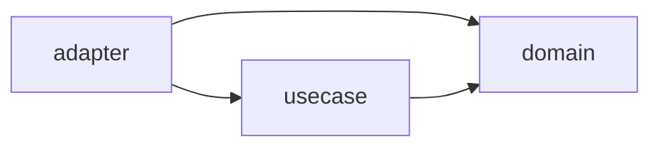

## はじめに

依存性ルールを図に描くだけでは、変更のたびに守られるとは限りません。まずは内側のパッケージが外側の実装を直接 import していないかを確認します。ここでは最小限の検査に絞り、継続的な検証や例外の運用は第22章で扱います。

## 依存の向きを決める

読書記録サービスの例では、`domain` が業務上のルール、`usecase` が処理の手順、`adapter` が HTTP やデータベースとの接続を担当します。`usecase` は `domain` を利用できますが、`domain` から `usecase` や `adapter` を参照しません。



たとえば `domain` が SQL の実装を直接 import している場合、データ保存の変更がドメインに波及します。必要な振る舞いを呼び出し側の小さな interface として表し、外側の実装を組み立て時に渡すことで、依存の向きを保てます。

Go は直接・間接を問わずパッケージの import 循環をビルド時に拒否します。ただし、循環がなくても `domain` から `adapter` への一方向の依存は作れるため、別途検査が必要です。

## まず一つの禁止を検査する

次の Bash 例は、モジュールパスを `example.com/reading` とする単一モジュールのルートで実行します。`internal/catalog/domain` とその子パッケージによる `internal/catalog/adapter` とその子パッケージへの**直接 import**を検出します。パスの区切りまで比較するため、`adapterextra` は対象に含みません。

```bash
set -o pipefail
go list -f '{{.ImportPath}} {{join .Imports " "}}' ./... |
  awk '
    function under(path, root) {
      return path == root || index(path, root "/") == 1
    }
    under($1, "example.com/reading/internal/catalog/domain") {
      for (i = 2; i <= NF; i++) {
        if (under($i, "example.com/reading/internal/catalog/adapter")) {
          print $1 " must not import " $i > "/dev/stderr"
          bad = 1
        }
      }
    }
    END { if (bad) exit 1 }
  '
```

違反があれば import 元と先を表示し、終了コードを非ゼロにします。`pipefail` により `go list` の失敗も見逃しません。検査対象は現在の環境とビルドタグで選ばれた通常の Go ファイルです。テストコード、別のビルドタグ、別のモジュール、間接依存はこのコマンドだけでは検査できません。

この一例は `usecase` や別の業務モジュールを網羅しません。禁止する関係をチームで決め、適合する例と違反例で検査自体を確かめたうえで、必要な範囲に広げます。第22章では、公開面や処理寿命など、import の検査だけでは守れないルールも扱います。

## まとめ

最初は守りたい境界を1つ選び、違反時に理由と修正の方向が分かる検査を用意します。ツールの数よりも、対象範囲と検査できないことを明示して継続実行することが重要です。

## 参考文献

- [Go command: list packages](https://pkg.go.dev/cmd/go#hdr-List_packages_or_modules)
- [Go: Organizing a Go module](https://go.dev/doc/modules/layout)
