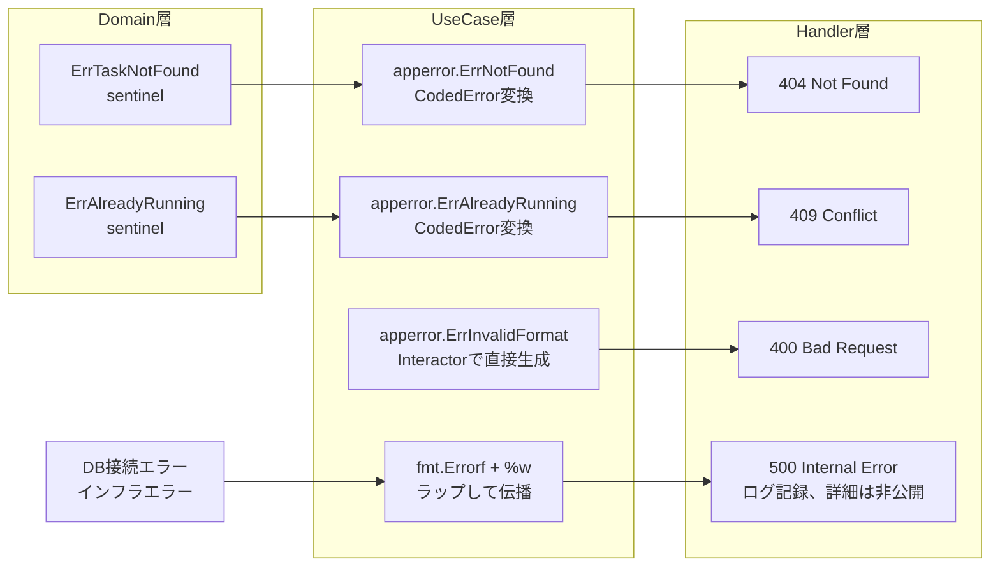

## はじめに

:::message

本章は、Go で DDD × クリーンアーキテクチャを採用したプロジェクトを運用する中で、エラーハンドリングに悩み調べてきた内容をまとめたものです。運用経験に基づく判断と、一次情報源で裏付けられる一般論を区別して書いています。一般論には参照リンクを付けています。

:::

DDD で設計された Go のプロジェクトで、最初に混乱したのがエラーハンドリングでした。

- ドメイン層のバリデーションエラーと DB の接続エラーが同じ`error`として返されます
- Handler 層で`err != nil`の中身を見て、400なのか500なのかを判断する if 文が増殖します
- エラーメッセージをそのままクライアントに返してしまい、内部構造が漏洩します

この章では、教科書通りのエラーハンドリングから始めて、**運用で見つかった課題と改善の過程**を共有します。

---

## エラーの3分類

まず教科書通りに、DDD のレイヤーに対応させてエラーを3つに分類しました。

| 分類 | 発生レイヤー | 例 | HTTP ステータス |
| --- | --- | --- | --- |
| ドメインエラー | Domain 層 | 「在庫が不足しています」「メールアドレスの形式が不正です」 | 400 / 409 / 422 |
| アプリケーションエラー | UseCase 層 | 「指定されたリソースが見つかりません」「権限がありません」 | 404 / 403 |
| インフラエラー | Infrastructure 層 | 「DB に接続できません」「外部 API がタイムアウトしました」 | 500 / 502 / 503 |

分類自体は正しいのですが、問題は**実装方法**でした。

---

## 最初の設計：sentinel error だけで始めた

最初は Go 標準の`errors.New`で sentinel error を定義しました。

```go
// domain/model/errors.go
var (
    ErrTaskNotFound       = errors.New("task not found")
    ErrTaskAlreadyRunning = errors.New("another task is already running")
    ErrInvalidCSVFormat   = errors.New("invalid CSV format")
    ErrDuplicateEmail     = errors.New("duplicate email in input")
    ErrInvalidEmailFormat = errors.New("invalid email format")
)
```

ドメインのエンティティではこれらを返します。

```go
// domain/model/import_job.go
// 現在時刻は引数で受け取り、テストで固定できるようにします（第15章と同じ方針）。
func (j *ImportJob) Start(totalCount int, now time.Time) error {
    if j.Status != StatusPending {
        return ErrTaskAlreadyRunning
    }
    j.Status = StatusProcessing
    j.TotalCount = totalCount
    j.StartedAt = &now
    return nil
}
```

利用側では`errors.Is`で判定します。

```go
// usecase/start_job_interactor.go
if err := job.Start(totalCount, i.now()); err != nil {
    if errors.Is(err, model.ErrTaskAlreadyRunning) {
        // 冪等に扱う（成功として返す）
        return nil
    }
    return err
}
```

この段階では問題なく動いていました。

---

## 課題：Handler 層での分岐が爆発した

プロジェクトが成長するにつれ、Handler 層のエラー処理がこうなりました。

```go
// ❌ Handler層でsentinel errorを個別に判定
func (h *JobHandler) CreateJob(w http.ResponseWriter, r *http.Request) {
    err := h.createJob.Execute(r.Context(), input)
    if err != nil {
        if errors.Is(err, model.ErrTaskAlreadyRunning) {
            writeJSON(w, http.StatusConflict, ErrorResponse{Message: err.Error()})
            return
        }
        if errors.Is(err, model.ErrInvalidCSVFormat) {
            writeJSON(w, http.StatusBadRequest, ErrorResponse{Message: err.Error()})
            return
        }
        if errors.Is(err, model.ErrDuplicateEmail) {
            writeJSON(w, http.StatusBadRequest, ErrorResponse{Message: err.Error()})
            return
        }
        // ... sentinel errorの数だけif文が増える
        writeJSON(w, http.StatusInternalServerError, ErrorResponse{Message: "内部エラーが発生しました"})
        return
    }
}
```

sentinel error が増えるたびに Handler 層の if 文が増殖します。**エラーの種類と HTTP ステータスの対応が散在**してしまいました。

---

## 改善：CodedError パターンの導入

sentinel error を維持しつつ、**エラーコードを持つ CodedError 型**を導入しました。UseCase 層は HTTP ステータスを知らず、コードだけを返します。コードから HTTP ステータスへの対応は、Handler 層の1箇所で決めます。

```go
// pkg/apperror/coded_error.go
package apperror

type CodedError struct {
    code    string
    message string
}

func (e *CodedError) Error() string {
    return e.message
}

func (e *CodedError) Code() string { return e.code }

func newCodedError(code, message string) *CodedError {
    return &CodedError{code: code, message: message}
}
```

エラーをカテゴリごとに定義します。

```go
// pkg/apperror/codes.go
var (
    // バリデーション系
    ErrInvalidFormat  = newCodedError("VAL001", "invalid format")
    ErrDuplicateEntry = newCodedError("VAL002", "duplicate entry")

    // 競合系
    ErrAlreadyRunning = newCodedError("CONF001", "resource is already running")

    // 認証・認可系
    ErrAuthRequired = newCodedError("AUTH001", "authentication required")
    ErrForbidden    = newCodedError("AUTH002", "permission denied")

    // リソース系
    ErrNotFound = newCodedError("RES001", "resource not found")

    // 内部エラー系
    ErrInternal = newCodedError("SYS001", "internal error")
)
```

コードと HTTP ステータスの対応は、インターフェース層（Handler）に置きます。

```go
// interface/rest/handler/error_status.go
var statusByCode = map[string]int{
    "VAL001":  http.StatusBadRequest,
    "VAL002":  http.StatusBadRequest,
    "CONF001": http.StatusConflict,
    "AUTH001": http.StatusUnauthorized,
    "AUTH002": http.StatusForbidden,
    "RES001":  http.StatusNotFound,
    "SYS001":  http.StatusInternalServerError,
}

func httpStatusOf(code string) int {
    if status, ok := statusByCode[code]; ok {
        return status
    }
    return http.StatusInternalServerError
}
```

なぜ HTTP ステータスを CodedError に持たせないのかというと、UseCase 層が HTTP の語彙に依存しなくて済むためです。同じ UseCase を gRPC や CLI から呼ぶ場合、ステータスの対応は入口ごとに変わります。

### Handler 層がシンプルになる

CodedError を導入したことで、Handler 層のエラー処理を**1箇所に集約**できました。

```go
// interface/rest/handler/error_handler.go
func HandleError(w http.ResponseWriter, err error) {
    var coded *apperror.CodedError
    if errors.As(err, &coded) {
        writeJSON(w, httpStatusOf(coded.Code()), ErrorResponse{
            Code:    coded.Code(),
            Message: coded.Error(),
        })
        return
    }

    // CodedErrorでないエラーはすべて内部エラー
    slog.Error("unhandled error", "error", err)
    internal := apperror.ErrInternal
    writeJSON(w, httpStatusOf(internal.Code()), ErrorResponse{
        Code:    internal.Code(),
        Message: internal.Error(),
    })
}
```

```go
// Handler層は err を渡すだけ
func (h *JobHandler) CreateJob(w http.ResponseWriter, r *http.Request) {
    result, err := h.createJob.Execute(r.Context(), input)
    if err != nil {
        HandleError(w, err)
        return
    }
    writeJSON(w, http.StatusCreated, result)
}
```

これにより、if 文の分岐がなくなりました。`HandleError`は`errors.As`で**型**（`*CodedError`）を判定しているため、どの`CodedError`でも同じ処理で扱えます。

なお、`apperror.ErrNotFound`などはパッケージレベルのポインタ変数なので、`errors.Is(err, apperror.ErrNotFound)`による値の比較も機能します。特定のエラー種別を Handler 層で区別したい場合は`errors.Is`、全`CodedError`を一括処理する場合は`errors.As`が適しています。

`errors.Is`と`errors.As`はどちらもエラーチェーンを辿って判定します。`fmt.Errorf("context: %w", apperror.ErrNotFound)`のようにラップされていても、`HandleError`は`*CodedError`を取り出せます。

---

## ドメインエラーと CodedError の使い分け

ドメイン層では sentinel error を使い、UseCase 層（Interactor）で CodedError に変換します。

```go
// domain/model/errors.go（変更なし）
var (
    ErrTaskAlreadyRunning = errors.New("another task is already running")
    ErrInvalidCSVFormat   = errors.New("invalid CSV format")
)
```

```go
// usecase/create_job_interactor.go
func (i *CreateJobInteractor) Execute(ctx context.Context, req *CreateJobInput) (*CreateJobOutput, error) {
    // バリデーション（簡略化のため汎用エラーを返している）
    if err := i.validateInput(req); err != nil {
        return nil, apperror.ErrInvalidFormat  // CodedError
    }
    // NOTE: 実際のAPIでは「どのフィールドが不正か」をクライアントに返す必要があります。
    // フィールドレベルのバリデーションエラーは CodedError を拡張して details フィールドを
    // 持たせるか、専用の ValidationError 型を定義するのが実践的です。

    // 排他チェック
    running, err := i.jobRepo.ExistsPendingOrProcessing(ctx)
    if err != nil {
        return nil, fmt.Errorf("failed to check running jobs: %w", err)  // インフラエラー
    }
    if running {
        return nil, apperror.ErrAlreadyRunning  // CodedError
    }

    // ドメインオブジェクト生成
    job := model.NewImportJob(req.Data, req.WebhookURL)
    if err := i.jobRepo.Save(ctx, job); err != nil {
        return nil, fmt.Errorf("failed to save job: %w", err)  // インフラエラー
    }

    return &CreateJobOutput{JobID: job.ID}, nil
}
```

### なぜドメイン層は sentinel error のままなのか

ドメイン層は**HTTP ステータスとエラーコードのどちらも知るべきではない**からです。ドメインの関心事は「ビジネスルール違反が起きたこと」であり、HTTP 400や409への変換はプレゼンテーションの責務です。UseCase 層は CodedError のコードまでを決め、そのコードを HTTP ステータスに変えるのは Handler 層です。

```go
// usecase/get_job_interactor.go
func (i *GetJobInteractor) Execute(ctx context.Context, id string) (*GetJobOutput, error) {
    job, err := i.repo.FindByID(ctx, id)
    if err != nil {
        if errors.Is(err, model.ErrTaskNotFound) {
            return nil, apperror.ErrNotFound  // sentinel → CodedError
        }
        return nil, fmt.Errorf("failed to get job: %w", err)
    }
    return &GetJobOutput{Job: job}, nil
}
```

---

## インフラ層でのエラー変換

### 教科書の主張と実務のギャップ

クリーンアーキテクチャの解説では「インフラ層はインフラエラーをそのまま返し、UseCase 層で解釈すべき」と述べられることがあります。しかし実際に運用してみると、**インフラ層で DB エラーをドメインエラーに変換する**方が扱いやすい場面は多くありました。

```go
// infrastructure/postgres/job_repository.go
func (r *jobRepository) FindByID(ctx context.Context, id string) (*model.ImportJob, error) {
    var dest jobRow
    result := r.db.Where("id = ?", id).First(&dest)
    if result.Error != nil {
        if errors.Is(result.Error, gorm.ErrRecordNotFound) {
            return nil, model.ErrTaskNotFound  // ドメインのsentinel errorに変換
        }
        return nil, fmt.Errorf("failed to find job: %w", result.Error)
    }
    return r.toDomainModel(&dest), nil
}
```

`gorm.ErrRecordNotFound`を`model.ErrTaskNotFound`に変換しています。ヘキサゴナルアーキテクチャでは、アダプター（Repository 実装）が技術的なエラーをドメインが理解できる形に変換する責務を持つとされており、この変換は**境界での翻訳**として合理的だと考えています。

ただし、この変換ロジックのユニットテストには DB のモックや testcontainers が必要になる点は留意してください。

### なぜ境界での変換が合理的か

1. **Interactor が`gorm`パッケージを知らずに済む** — Interactor で`gorm.ErrRecordNotFound`を判定すると、インフラ詳細への依存が生まれます。
2. **Repository はドメインとインフラの境界である** — Repository interface は domain 層に定義されています。その実装は「ドメインの言葉に翻訳して返す」責務を持っています。

なお、この設計ではインフラ層がドメインの sentinel error（`model.ErrTaskNotFound`）に依存します。ドメインのエラーシンボルを変更するとインフラ層にも波及します。ただし、Infrastructure→Domain の方向はクリーンアーキテクチャの依存方向として正しいため、許容範囲と判断しました。

### 変換すべきでないケース

一方、**Repository 層が CodedError を直接返す**パターンは避けるべきです。

```go
// ❌ Repository層がHTTPステータスを含むCodedErrorを返している
func (r *userRepository) Save(ctx context.Context, u *model.User) error {
    result := r.db.Create(r.toDBModel(u))
    if result.Error != nil {
        if isDuplicateKeyError(result.Error) {
            return apperror.ErrDuplicateEntry  // CodedError（HTTP 400を含む）
        }
        return result.Error
    }
    return nil
}
```

`apperror.ErrDuplicateEntry`は HTTP ステータス400を内包しています。Repository 層がこの型を返すと、インフラ層が HTTP レスポンスの知識を持つことになり、レイヤー間の責務が曖昧になります。

### 変換場所の判断基準

「どのエラーをどこで変換するか」の判断基準を明文化しないと、属人的な判断になりがちです。私のプロジェクトでは次のルールを設けました。

| 変換元 | 変換先 | 変換場所 | 例 |
| --- | --- | --- | --- |
| DB 固有エラー | ドメイン sentinel error | Repository 層 | `gorm.ErrRecordNotFound` → `model.ErrTaskNotFound` |
| DB 固有エラー | ラップして伝播 | Repository 層 | 接続エラー → `fmt.Errorf("failed: %w", err)` |
| ドメイン sentinel error | CodedError | UseCase 層 | `model.ErrDuplicateEmail` → `apperror.ErrDuplicateEntry` |

ルールは1つです。**Repository 層はドメインの sentinel error までしか返さず、CodedError への変換は UseCase 層が担います**。`FindByID`の例と同じパターンを、一意制約違反にも適用します。

### 一意制約違反の変換例

```go
// infrastructure/postgres/user_repository.go
// ✅ Repository層はDB固有エラーをドメインのsentinel errorに変換する
func (r *userRepository) Save(ctx context.Context, u *model.User) error {
    result := r.db.Create(r.toDBModel(u))
    if result.Error != nil {
        if isDuplicateKeyError(result.Error) {
            return model.ErrDuplicateEmail  // ドメインのsentinel errorに変換
        }
        return fmt.Errorf("failed to save user: %w", result.Error)
    }
    return nil
}

// isDuplicateKeyError はDBドライバ固有の一意制約違反を判定します。
// PostgreSQLの場合、pgconn.PgError の Code が "23505" かどうかで判定します。
func isDuplicateKeyError(err error) bool {
    var pgErr *pgconn.PgError
    return errors.As(err, &pgErr) && pgErr.Code == "23505"
}
```

```go
// usecase/create_user_interactor.go
// ✅ UseCase層でsentinel errorをCodedErrorに変換する
func (i *CreateUserInteractor) Execute(ctx context.Context, input *CreateUserInput) error {
    user := model.NewUser(input.Name, input.Email)
    if err := i.userRepo.Save(ctx, user); err != nil {
        if errors.Is(err, model.ErrDuplicateEmail) {
            return apperror.ErrDuplicateEntry  // sentinel → CodedError
        }
        return fmt.Errorf("failed to save user: %w", err)
    }
    return nil
}
```

この構造は`FindByID`と同じパターンです。Repository 層は DB 固有エラーをドメインの sentinel error に変換し、UseCase 層は sentinel error を CodedError に変換します。各レイヤーの変換責務が一貫しているため、新しいエラーが増えても同じルールで判断できます。

---

## エラーの流れ全体像



---

## セキュリティの観点

エラーハンドリングは**セキュリティの多層防御**の一部でもあります。

### インフラエラーの詳細をクライアントに返さない

```go
// ❌ SQLエラーがそのまま露出
writeJSON(w, 500, map[string]string{
    "error": err.Error(), // "pq: password authentication failed for user \"app\""
})

// ✅ CodedErrorでないエラーは汎用メッセージに変換
slog.Error("unhandled error", "error", err)
internal := apperror.ErrInternal
writeJSON(w, httpStatusOf(internal.Code()), ErrorResponse{
    Code:    internal.Code(),
    Message: internal.Error(),
})
```

### 存在確認のエラーで情報を漏らさない

```go
// ❌ ユーザーの存在が推測できる
// POST /login → "パスワードが間違っています"

// ✅ 存在を推測させない
// POST /login → "メールアドレスまたはパスワードが間違っています"
```

### HTTP ステータスコードでリソースの存在を推測させない

`404 Not Found`と`403 Forbidden`を使い分けると、リソースの存在が推測できてしまいます。認可エラーでもリソースの存在を隠したい場合は、「存在しない」場合とまったく同じ応答を返す設計を検討してください。

ステータスだけを`404`に変えても不十分です。本文のコードやメッセージが`AUTH002`と`RES001`で異なれば、クライアントは両者を区別できます。存在を隠す操作では、ステータス、コード、メッセージのすべてをそろえます。

```go
// 存在を隠したいリソースの入口で使う変換です。
// 認可エラーを「見つからない」に置き換え、ステータス・コード・メッセージをそろえます。
func concealExistence(err error) error {
    if errors.Is(err, apperror.ErrForbidden) {
        return apperror.ErrNotFound
    }
    return err
}

func (h *JobHandler) GetJob(w http.ResponseWriter, r *http.Request) {
    result, err := h.getJob.Execute(r.Context(), r.PathValue("id"))
    if err != nil {
        HandleError(w, concealExistence(err))
        return
    }
    writeJSON(w, http.StatusOK, result)
}
```

置き換える前のエラーは、調査のためにサーバー側のログへ記録します。応答をそろえても、処理時間の差から存在を推測できる場合があります。その差が問題になる操作では、別に対策が必要です。

### スタックトレースをクライアントに返さない

本番環境では、スタックトレースはログに記録し、クライアントにはエラーコードのみを返します。

---

## まとめ

| レイヤー | エラーの責務 | 実装パターン |
| --- | --- | --- |
| Domain | ビジネスルール違反を表現する | sentinel error（`errors.New`） |
| Infrastructure | DB エラーをドメインの言葉に翻訳する | 「見つからない」→ sentinel error、それ以外 → `%w`でラップ |
| UseCase | ドメインエラーを CodedError に変換する | `apperror.ErrXxx`を返す（HTTP は知らない） |
| Handler | CodedError のコードを HTTP ステータスに変換する | `errors.As`で型判定、対応表で1箇所に集約 |

最初は sentinel error だけで始め、Handler 層の if 文が爆発した時点で CodedError を導入しました。段階的に改善できるのがこのパターンの利点です。

重要なのは**エラーの変換場所を明確にする**ことです。「見つからない」のような事実の翻訳は Repository 層で、「重複エントリ」のようなビジネス判断は UseCase 層で行います。

---

## 参考文献

| 内容 | 出典 |
| --- | --- |
| Go のエラーハンドリング | Go Blog, [Working with Errors in Go 1.13](https://go.dev/blog/go1.13-errors) |
| DDD のエラー設計 | Vaughn Vernon, _Implementing Domain-Driven Design_（2013） |
| エラー設計の考え方 | Dave Cheney, [Don't just check errors, handle them gracefully](https://dave.cheney.net/2016/04/27/dont-just-check-errors-handle-them-gracefully)（2016年。`errors.Is`/`errors.As`導入前の記事ですが、エラーを呼び出し元に判断させる設計思想は現在も有効です） |
| セキュリティ観点のエラー処理 | OWASP, [Improper Error Handling](https://owasp.org/www-community/Improper_Error_Handling) |
