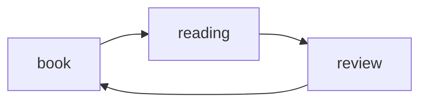

## はじめに

依存性ルールを理解しても、コードをレイヤー別のディレクトリへ並べるだけでは、変更の影響範囲を十分に閉じ込められません。機能が増えるほど、1つの変更が `domain/`、`usecase/`、`interface/`、`infrastructure/` を横断し、互いに関係のない機能まで同じパッケージへ集まりやすくなります。

本章では、まず変更のまとまりでモジュールを作り、必要なモジュールだけ内部をレイヤーに分ける方法を扱います。焦点は、Go の package と `internal` を使ってコード上の境界を表現することです。

モジュールを別プロセスへ分けるか、1つのサービスとしてデプロイするかは次章で判断します。

## この章で答える問い

- レイヤー別構成だけでは、なぜ変更の影響が広がるのか
- 機能単位のモジュールとレイヤーをどう組み合わせるのか
- Go の公開識別子と `internal` で、何を守れるのか
- モジュール間の依存をどこまで許すのか

## レイヤー別構成の限界

次の構成は、依存方向を説明するには分かりやすい一方、機能のまとまりが見えにくくなります。

```text
internal/
├── domain/
│   ├── book.go
│   ├── reading.go
│   ├── review.go
│   └── user.go
├── usecase/
│   ├── register_book.go
│   ├── complete_reading.go
│   └── post_review.go
├── interface/
└── infrastructure/
```

読了機能を変更するとき、複数のトップレベルディレクトリを行き来します。また、`domain` という大きなパッケージに無関係なモデルが集まり、意図しない依存を作りやすくなります。

ここで問題なのは、レイヤーがあることではありません。変更の単位より先にレイヤーをトップレベルの分割軸にしていることです。

## まず機能単位で分ける

読書ログサービスを、変更理由の異なる機能で分けます。

```text
internal/
├── book/
├── reading/
├── review/
└── user/
```

- `book`: 書籍情報の登録と参照
- `reading`: 読書開始、進捗、読了
- `review`: 評価とレビュー本文
- `user`: 利用者のプロフィール

この段階で、すべてのモジュールに同じ4層を作る必要はありません。単純なモジュールは少数のファイルから始めます。

```text
internal/
└── review/
    ├── review.go
    ├── post.go
    └── repository.go
```

責務が増えたモジュールだけ、内部をレイヤーに分けます。

```text
internal/
└── reading/
    ├── domain/
    │   ├── reading.go
    │   └── repository.go
    ├── usecase/
    │   ├── start_reading.go
    │   └── complete_reading.go
    └── adapter/
        ├── http/
        └── postgres/
```

大切なのは全モジュールの見た目をそろえることではなく、依存方向と公開範囲を説明できることです。

## モジュールの公開面を小さくする

Go では先頭が大文字の識別子が package 外へ公開されます。しかし、公開できるものをすべて公開すると、モジュール内部の変更が他モジュールへ波及します。

たとえば `reading` モジュールの利用側に必要なのが「読書を開始する」操作だけなら、公開面をその操作へ絞ります。

```go
package reading

type StartCommand struct {
    UserID string
    BookID string
}

type Starter interface {
    Start(ctx context.Context, cmd StartCommand) error
}
```

内部の集約、永続化モデル、SQL 行構造体を公開 API に含めません。

```go
// 外部へ公開しない
// type readingRow struct { ... }
// type postgresRepository struct { ... }
```

公開 API を考えるときは、次を確認します。

- 利用側が本当に必要とする操作か
- 内部の永続化形式を漏らしていないか
- setter の集合ではなく、業務上の操作になっているか
- 将来変更したい詳細を型に露出していないか

## `internal` でアクセス範囲を強制する

Go の `internal` ディレクトリは、親ディレクトリの外側からの import をコンパイラが拒否します。リポジトリ全体を1つのアプリケーションとして閉じるなら、次の構成が基本になります。

```text
booklog/
├── cmd/
│   └── api/
│       └── main.go
├── internal/
│   ├── book/
│   ├── reading/
│   ├── review/
│   └── user/
└── go.mod
```

モジュール内部をさらに隠したい場合は、ネストした `internal` を使えます。

```text
internal/
└── reading/
    ├── reading.go              # モジュールの公開面
    └── internal/
        ├── domain/
        ├── usecase/
        └── postgres/
```

`reading/internal/...` を import できるのは `reading` 配下だけです。これにより、別モジュールが集約や Repository 実装へ直接依存することを防げます。

:::message

`internal` が守るのはディレクトリに基づく import 範囲です。「review から book の公開 API を呼んではいけない」といった業務上の依存ルールまでは表現できません。より細かなルールは、第4章の最小チェックと第22章の Architecture Fitness Functions で検証します。

:::

## 利用側が必要とする interface を定義する

別モジュールの具象型へ直接依存する代わりに、利用側が必要な能力を小さな interface で表します。

```go
package reading

type BookFinder interface {
    Exists(ctx context.Context, bookID string) (bool, error)
}

type StartReadingInteractor struct {
    books BookFinder
    repo  Repository
}
```

`reading` が必要なのは `book.Book` の全フィールドではなく、「対象の本が存在するか」です。この interface を `reading` 側に置くことで、依存の理由を利用側の言葉で表現できます。

同一プロセスでは `book` モジュールを呼ぶ adapter を使えます。

```go
package moduleadapter

type BookFinder struct {
    books book.QueryService
}

func (f BookFinder) Exists(ctx context.Context, id string) (bool, error) {
    _, err := f.books.Find(ctx, id)
    if errors.Is(err, book.ErrNotFound) {
        return false, nil
    }
    return err == nil, err
}
```

この adapter は composition root で組み立てます。将来プロセスを分けても、`reading` の UseCase が HTTP クライアントの詳細を直接知る必要はありません。

## モジュール間で型を共有し過ぎない

共有 package は便利ですが、無関係な変更を結び付けやすくなります。

```text
internal/shared/
├── model/
├── repository/
├── event/
└── util/
```

このような `shared` が大きくなると、実質的な新しいモノリスになります。共有する前に、次の代替を検討します。

1. その型を所有するモジュールを決める
2. 利用側で必要な小さな型へ変換する
3. module adapter で翻訳する
4. 本当に同じ意味・変更理由を持つ値だけ共有する

たとえば `BookID` と `ReadingID` はどちらも文字列で実装できても、意味と所有者が違います。便利さだけを理由に `shared.ID` へ統合しません。

## データの所有者を決める

同じ DB を使う段階でも、どのモジュールがどのデータを書き込むかを決めます。

| テーブル   | 書き込みを所有するモジュール | 他モジュールからの利用                |
| ---------- | ---------------------------- | ------------------------------------- |
| `books`    | `book`                       | 公開 API または query 経由            |
| `readings` | `reading`                    | 公開 API または event 経由            |
| `reviews`  | `review`                     | 公開 API 経由                         |
| `users`    | `user`                       | 公開 API または必要な read model 経由 |

同じ DB 接続を共有していても、他モジュールのテーブルへ直接 `UPDATE` すると、所有境界は崩れます。JOIN が必要な読み取りについては、整合性、性能、変更頻度を踏まえ、専用 query service や read model を検討します。

## 依存グラフを単純に保つ

モジュールが互いに自由に呼び合うと、package の循環 import を避けられても、設計上の循環依存ができます。



まず、依存方向を一方向にできないか考えます。


どうしても双方向の連携が必要なら、次を検討します。

- orchestrator を上位の application package に置く
- 一方をイベント通知にする
- 共通の抽象ではなく、利用側ごとの port を定義する
- そもそも境界の切り方が適切か見直す

循環を解消するためだけに巨大な `shared` package を作るのは避けます。

## Go module と業務モジュールを混同しない

本章でいう「モジュール」は、業務上の変更をまとめる設計単位です。`go.mod` が定義する Go module は、バージョンと依存解決の単位です。

1つの Go module の中に複数の業務モジュールを置けます。

```text
booklog/                  # 1 Go module
├── go.mod
└── internal/
    ├── book/             # business module
    ├── reading/          # business module
    └── review/           # business module
```

複数の Go module に分けるのは、個別のバージョン管理、再利用、ビルド境界など明確な理由がある場合です。業務境界が見えたという理由だけで `go.mod` を増やす必要はありません。

同様に、Go Workspace は複数の Go module をローカルで同時に開発する仕組みであり、サービス境界を決める仕組みではありません。

## 境界を維持するチェックリスト

- トップレベルの分割軸が、レイヤーだけでなく変更のまとまりになっているか
- 小さいモジュールへ最初から同じ数のレイヤーを強制していないか
- 公開 API に永続化形式や内部モデルが漏れていないか
- interface は利用側が必要とする能力を表しているか
- 他モジュールの内部 package やテーブルを直接利用していないか
- `shared` に異なる意味・変更理由の型を集めていないか
- モジュール間の依存グラフに循環がないか
- Go module、業務モジュール、サービスを同じ意味で使っていないか

## まとめ

| 観点         | 判断                                                       |
| ------------ | ---------------------------------------------------------- |
| 最初の分割軸 | レイヤーより先に変更のまとまりで分ける                     |
| レイヤー     | 複雑さが必要になったモジュール内へ導入する                 |
| 公開範囲     | 小さな公開 API と `internal` で制御する                    |
| interface    | 利用側が必要とする能力として定義する                       |
| データ       | 同じ DB でも書き込み所有者を決める                         |
| 共有         | 同じ意味と変更理由を持つものだけに絞る                     |
| Go module    | バージョン・依存解決の単位であり、業務境界とは別に判断する |

ここまでで、コード上の境界を作りました。しかし、`book`、`reading`、`review`、`user` を別プロセスにする必要があるとは限りません。次章では、モジュラーモノリスとして境界を育て、どの条件でサービスへ分割するかを考えます。

---

## 参考文献

| 内容 | 出典 |
| --- | --- |
| Go の package | [The Go Programming Language Specification - Packages](https://go.dev/ref/spec#Packages) |
| `internal` ディレクトリ | [Go Command Documentation - Internal Directories](https://pkg.go.dev/cmd/go#hdr-Internal_Directories) |
| Go module | [Go Modules Reference](https://go.dev/ref/mod) |
| Go Workspace | [Tutorial: Getting started with multi-module workspaces](https://go.dev/doc/tutorial/workspaces) |
