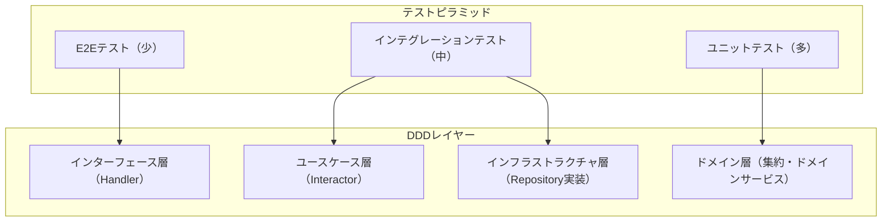
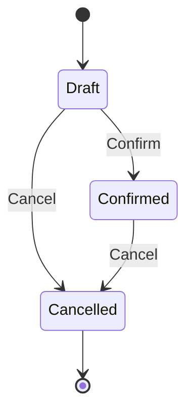

## はじめに

DDD で設計されたコードベースには、エンティティ、値オブジェクト、集約、ドメインサービス、リポジトリ、ユースケースなど、多くの構成要素があります。それぞれの要素をどのレベルでテストするかは、チームの生産性と品質に直結する重要な判断です。

Mike Cohn が提唱したテストピラミッドでは、ユニットテストを最も多く、インテグレーションテスト、E2E テストの順に減らすことが推奨されています（参考：[TestPyramid](https://martinfowler.com/bliki/TestPyramid.html)）。しかし DDD のレイヤー構造にこのピラミッドをどう対応させるかは、自明ではありません。

本章では、ドメイン層からインフラストラクチャ層までのテストに加え、処理の終了、プロセス間の配信、観測可能性を検証します。HTTP の境界も契約や trace のテスト対象に含めますが、画面操作を含む E2E テストの実装は扱いません。

---

## テストピラミッドと DDD レイヤーの対応

DDD のレイヤー構造とテストピラミッドの対応関係を整理します。



| DDD レイヤー | テストレベル | テスト対象 |
| --- | --- | --- |
| ドメイン層 | ユニットテスト | 集約の振る舞い、値オブジェクトの制約、ドメインサービスのロジック |
| ユースケース層 | インテグレーションテスト | ユースケースのフロー、依存コンポーネントの連携 |
| インフラストラクチャ層 | インテグレーションテスト | リポジトリのクエリ、外部サービスとの通信 |
| インターフェース層 | E2E テスト / HTTP テスト | API エンドポイントのリクエスト/レスポンス |

テストピラミッドの考え方に従えば、外部依存のないドメイン層はユニットテストの対象として最も適しており、投資対効果が高いと考えられます。

---

## ドメイン層のユニットテスト

ドメイン層の構成要素のうち、このセクションでは値オブジェクトと集約（エンティティ）のテストを扱います。それぞれテストの観点が異なります。

- **値オブジェクト**: 生成時の制約と等値性
- **集約**: 状態遷移を伴う振る舞い

ドメインサービスのテストは、モックの境界判断が加わるため、次のセクションで独立して解説します。

### 値オブジェクトのテスト

値オブジェクトは生成時の制約（バリデーション）と等値性をテストします。構造がシンプルなため、最もテストしやすい要素です。

```go
// domain/model/email_test.go
package model_test

import (
    "testing"

    "example/domain/model"
)

func TestNewEmail(t *testing.T) {
    tests := []struct {
        name    string
        input   string
        wantErr bool
    }{
        {name: "正常なメールアドレス", input: "user@example.com", wantErr: false},
        {name: "空文字列", input: "", wantErr: true},
        {name: "@がない", input: "userexample.com", wantErr: true},
        {name: "ドメインがない", input: "user@", wantErr: true},
        {name: "日本語ドメイン", input: "user@例え.jp", wantErr: false},
    }
    for _, tt := range tests {
        t.Run(tt.name, func(t *testing.T) {
            _, err := model.NewEmail(tt.input)
            if (err != nil) != tt.wantErr {
                t.Errorf("NewEmail(%q) error = %v, wantErr %v", tt.input, err, tt.wantErr)
            }
        })
    }
}

func TestEmail_Equality(t *testing.T) {
    email1, _ := model.NewEmail("user@example.com")
    email2, _ := model.NewEmail("user@example.com")
    email3, _ := model.NewEmail("other@example.com")

    // 比較可能な値オブジェクトは == で比較できます（第7章）。
    if email1 != email2 {
        t.Error("同じアドレスのEmailは等しいはずです")
    }
    if email1 == email3 {
        t.Error("異なるアドレスのEmailは等しくないはずです")
    }
}
```

### 集約の振る舞いテスト

集約のテストで重要なのは、**状態ではなく振る舞い**をテストすることです。内部のフィールドを直接検証するのではなく、コマンドを実行した結果として外部から観測可能な変化をテストします。

```go
// domain/model/order_test.go
// 非公開フィールドの状態を確認するため、model パッケージ内のテストとして書きます。
package model

import "testing"

func TestOrder_Confirm(t *testing.T) {
    t.Run("下書き状態の注文を確定できる", func(t *testing.T) {
        order := newTestOrder(t)

        err := order.Confirm()

        if err != nil {
            t.Fatalf("Confirm() でエラーが発生しました: %v", err)
        }
        if order.status != OrderStatusConfirmed {
            t.Errorf("ステータスが %v になりました。%v を期待していました",
                order.status, OrderStatusConfirmed)
        }
    })

    t.Run("確定済みの注文は再度確定できない", func(t *testing.T) {
        order := newTestOrder(t)
        _ = order.Confirm()

        err := order.Confirm()

        if err == nil {
            t.Error("確定済みの注文に対する Confirm() はエラーを返すべきです")
        }
    })

    t.Run("キャンセル済みの注文は確定できない", func(t *testing.T) {
        order := newTestOrder(t)
        _ = order.Cancel()

        err := order.Confirm()

        if err == nil {
            t.Error("キャンセル済みの注文に対する Confirm() はエラーを返すべきです")
        }
    })
}

// newTestOrder はテスト用の注文を生成するヘルパーです。
func newTestOrder(t *testing.T) *Order {
    t.Helper()
    item, err := NewOrderItem("product-1", "テスト商品", 1000, 2)
    if err != nil {
        t.Fatalf("テスト用明細の生成に失敗しました: %v", err)
    }
    order, err := NewOrder("order-1", []OrderItem{item})
    if err != nil {
        t.Fatalf("テスト用注文の生成に失敗しました: %v", err)
    }
    return &order // NewOrder は値を返すため、アドレスを渡します
}
```

### 状態遷移のテーブル駆動テスト

集約の状態遷移が複雑な場合、テーブル駆動テストで代表的なパターンを網羅します。

```go
func TestOrder_StateTransitions(t *testing.T) {
    type action func(*Order) error

    confirm := func(o *Order) error { return o.Confirm() }
    cancel := func(o *Order) error { return o.Cancel() }

    tests := []struct {
        name       string
        setup      []action // 事前に実行するアクション
        action     action   // テスト対象のアクション
        wantErr    bool
        wantStatus OrderStatus // エラーを期待するケースでは確認しません
    }{
        {"Draft→Confirmed", nil, confirm, false, OrderStatusConfirmed},
        {"Draft→Cancelled", nil, cancel, false, OrderStatusCancelled},
        {"Confirmed→Cancelled", []action{confirm}, cancel, false, OrderStatusCancelled},
        {"Confirmed→Confirmed", []action{confirm}, confirm, true, 0},
        {"Cancelled→Confirmed", []action{cancel}, confirm, true, 0},
        {"Cancelled→Cancelled", []action{cancel}, cancel, true, 0},
    }

    for _, tt := range tests {
        t.Run(tt.name, func(t *testing.T) {
            order := newTestOrder(t)
            for _, a := range tt.setup {
                if err := a(order); err != nil {
                    t.Fatalf("セットアップアクションでエラーが発生しました: %v", err)
                }
            }

            err := tt.action(order)

            if (err != nil) != tt.wantErr {
                t.Errorf("error = %v, wantErr %v", err, tt.wantErr)
            }
            if !tt.wantErr && order.status != tt.wantStatus {
                t.Errorf("status = %v, want %v", order.status, tt.wantStatus)
            }
        })
    }
}
```

状態遷移図と対応させると、テストの漏れを発見しやすくなります。



---

## ドメインサービスのテスト

### モックの境界を見極める

ドメインサービスのテストでは、**モックの使用範囲を慎重に判断する**必要があります。基本的な方針は次のとおりです。

- **ドメイン層の内部（値オブジェクト、エンティティ）**: モックしません。実際のオブジェクトを使います
- **リポジトリ**: モックします。テストの対象はドメインロジックであり、データアクセスではありません
- **外部サービスのポート**: モックします。テストの安定性と速度のためです

```go
// domain/service/pricing_service_test.go
package service_test

import (
    "context"
    "testing"

    "example/domain/model"
    "example/domain/service"
)

// discountRuleFinder はテスト用のスタブです。
type discountRuleFinder struct {
    rules []model.DiscountRule
}

func (f *discountRuleFinder) FindApplicableRules(
    ctx context.Context,
    customerID string,
) ([]model.DiscountRule, error) {
    return f.rules, nil
}

func TestPricingService_CalculateTotal(t *testing.T) {
    t.Run("割引ルールが適用される", func(t *testing.T) {
        finder := &discountRuleFinder{
            rules: []model.DiscountRule{
                model.NewPercentageDiscount("会員割引", 10),
            },
        }
        svc := service.NewPricingService(finder)
        item, _ := model.NewOrderItem("p1", "商品", 10000, 1)
        items := []model.OrderItem{item}

        total, err := svc.CalculateTotal(context.Background(), "customer-1", items)

        if err != nil {
            t.Fatalf("CalculateTotal() error = %v", err)
        }
        // 10000円の10%割引 = 9000円
        if total != 9000 {
            t.Errorf("total = %d, want 9000", total)
        }
    })

    t.Run("割引ルールがない場合は定価", func(t *testing.T) {
        finder := &discountRuleFinder{rules: nil}
        svc := service.NewPricingService(finder)
        item, _ := model.NewOrderItem("p1", "商品", 500, 2)
        items := []model.OrderItem{item}

        total, err := svc.CalculateTotal(context.Background(), "customer-1", items)

        if err != nil {
            t.Fatalf("CalculateTotal() error = %v", err)
        }
        if total != 1000 {
            t.Errorf("total = %d, want 1000", total)
        }
    })
}
```

### モックライブラリを使わない理由

本章では、モックライブラリではなく、テストファイル内に定義したスタブ構造体を使います。理由は次のとおりです。

- **Go の interface は暗黙的**に満たされるため、テスト用のスタブを簡単に作成できます
- **interface が小さい**（1〜2メソッド）場合、モック生成ツールのオーバーヘッドが利点を上回ります
- **テストコードが自己完結**するため、テストファイルだけで依存関係が把握できます

ただし、interface のメソッド数が多い場合や、呼び出し回数の検証が必要な場合は、モックライブラリの利用も合理的な選択です。

---

## ユースケース層のテスト

### ユースケースのテスト戦略

ユースケース層のテストは、リポジトリやイベントバスをテストダブルに差し替え、ユースケースの振る舞いを検証する**コンポーネントテスト**です。ドメインオブジェクトは実物を使い、インフラストラクチャの実装には依存しません。

次の例はプロセス内イベントの呼び出しを観察するもので、DB 更新と外部配信の原子性は保証しません。外部への配信に Outbox を使う場合は、後述の実 DB を用いたテストが別途必要です。また、このフェイクはポインターを共有するため、`Save` 前の変更も見えます。保存の成否やロールバックを検証する用途には使えません。

```go
// usecase/confirm_order_test.go
package usecase_test

import (
    "context"
    "fmt"
    "testing"

    "example/domain/event"
    "example/domain/model"
    "example/usecase"
)

type inMemoryOrderRepo struct {
    orders map[string]*model.Order
}

func newInMemoryOrderRepo() *inMemoryOrderRepo {
    return &inMemoryOrderRepo{orders: make(map[string]*model.Order)}
}

func (r *inMemoryOrderRepo) FindByID(ctx context.Context, id string) (*model.Order, error) {
    order, ok := r.orders[id]
    if !ok {
        return nil, fmt.Errorf("注文が見つかりません: %s", id)
    }
    return order, nil
}

func (r *inMemoryOrderRepo) Save(ctx context.Context, order *model.Order) error {
    r.orders[order.ID()] = order
    return nil
}

type spyEventBus struct {
    published []event.Event
}

func (b *spyEventBus) Publish(events ...event.Event) error {
    b.published = append(b.published, events...)
    return nil
}

func (b *spyEventBus) Subscribe(string, event.Handler) {}

func TestConfirmOrderInteractor(t *testing.T) {
    t.Run("注文を確定してイベントを発行する", func(t *testing.T) {
        repo := newInMemoryOrderRepo()
        bus := &spyEventBus{}
        item, err := model.NewOrderItem("p1", "商品", 1000, 1)
        if err != nil {
            t.Fatalf("テスト用明細の生成に失敗しました: %v", err)
        }
        order, err := model.NewOrder("order-1", []model.OrderItem{item})
        if err != nil {
            t.Fatalf("テスト用注文の生成に失敗しました: %v", err)
        }
        repo.orders["order-1"] = &order

        uc := usecase.NewConfirmOrderInteractor(repo, bus)
        err = uc.Execute(context.Background(), "order-1")

        if err != nil {
            t.Fatalf("Execute() error = %v", err)
        }
        // 状態は非公開のため、永続化用の Snapshot（第8章）で確定済みであることを確かめます。
        // 「再確定がエラーになる」だけでは、誤ってキャンセルした場合と区別できません。
        if got := repo.orders["order-1"].Snapshot().Status; got != model.OrderStatusConfirmed {
            t.Errorf("status = %v, want %v", got, model.OrderStatusConfirmed)
        }
        if len(bus.published) == 0 {
            t.Error("ドメインイベントが発行されていません")
        }
    })

    t.Run("存在しない注文はエラーになる", func(t *testing.T) {
        repo := newInMemoryOrderRepo()
        bus := &spyEventBus{}

        uc := usecase.NewConfirmOrderInteractor(repo, bus)
        err := uc.Execute(context.Background(), "not-found")

        if err == nil {
            t.Error("存在しない注文に対する Execute() はエラーを返すべきです")
        }
    })
}
```

### テストダブルの使い分け

| 種類             | 用途                         | 例                   |
| ---------------- | ---------------------------- | -------------------- |
| スタブ（Stub）   | 固定値を返す                 | `discountRuleFinder` |
| スパイ（Spy）    | 呼び出しを記録する           | `spyEventBus`        |
| フェイク（Fake） | 簡易実装を提供する           | `inMemoryOrderRepo`  |
| モック（Mock）   | 期待される呼び出しを検証する | gomock 生成のモック  |

DDD のテストでは、スタブ・フェイク・スパイで十分なケースがほとんどだと考えています。モックの検証（「このメソッドが何回呼ばれたか」）は実装の詳細に依存するため、過度に使うとリファクタリング耐性が下がります。

---

## インフラストラクチャ層のテスト

### リポジトリのインテグレーションテスト

リポジトリの実装は実際のデータベースに対してテストします。Go では `testing` パッケージの `TestMain` でデータベースのセットアップを行えます。次の断片は `postgres` という名前で登録した SQL ドライバーと、適用済みのテスト用スキーマが別途必要です。ドライバーの登録方法は採用する実装に合わせます。

```go
// infrastructure/postgres/order_repository_test.go
package postgres_test

import (
    "context"
    "database/sql"
    "fmt"
    "os"
    "testing"

    "example/domain/model"
    "example/infrastructure/postgres"
)

var testDB *sql.DB

func TestMain(m *testing.M) {
    var err error
    testDB, err = sql.Open("postgres", os.Getenv("TEST_DATABASE_URL"))
    if err != nil {
        panic(err)
    }
    if err := testDB.Ping(); err != nil {
        panic(fmt.Sprintf("データベースに接続できません: %v", err))
    }
    code := m.Run()
    testDB.Close()
    os.Exit(code)
}

func TestOrderRepository_SaveAndFindByID(t *testing.T) {
    repo := postgres.NewOrderRepository(testDB)
    ctx := context.Background()

    // クリーンアップを先に登録する（Save が失敗しても確実に実行される）
    t.Cleanup(func() {
        testDB.Exec("DELETE FROM orders WHERE id = $1", "test-order-1")
    })

    item, err := model.NewOrderItem("p1", "商品", 1000, 2)
    if err != nil {
        t.Fatalf("テスト用明細の生成に失敗しました: %v", err)
    }
    order, err := model.NewOrder("test-order-1", []model.OrderItem{item})
    if err != nil {
        t.Fatalf("テスト用注文の生成に失敗しました: %v", err)
    }

    // Save
    if err := repo.Save(ctx, &order); err != nil {
        t.Fatalf("Save() error = %v", err)
    }

    // FindByID
    found, err := repo.FindByID(ctx, "test-order-1")
    if err != nil {
        t.Fatalf("FindByID() error = %v", err)
    }
    if found.ID() != order.ID() {
        t.Errorf("ID = %q, want %q", found.ID(), order.ID())
    }
    if found.TotalPrice() != order.TotalPrice() {
        t.Errorf("TotalPrice = %d, want %d", found.TotalPrice(), order.TotalPrice())
    }
    // 状態が別の値として復元されていないことも確かめます。
    if got, want := found.Snapshot().Status, order.Snapshot().Status; got != want {
        t.Errorf("Status = %v, want %v", got, want)
    }
}
```

テスト用データベースには、本番と同じスキーマを持つ別のデータベースを使います。[testcontainers-go](https://github.com/testcontainers/testcontainers-go) を使えば、テスト実行時に Docker コンテナで一時的な PostgreSQL を起動できます。

---

## キャンセルと処理の終了を検証する

キャンセルのテストでは、処理開始をチャネルで観測してからキャンセルし、待機中の下流呼び出しまで通知されることを確認します。固定時間の sleep で開始を推測せず、タイムアウトはテストが永遠に止まらないための上限として使います。

次の実行可能な例では、`load` が下流処理を表します。キャンセルが渡されなければテストはタイムアウトで失敗します。

```go
package lifecycle_test

import (
    "context"
    "errors"
    "testing"
    "time"
)

func load(ctx context.Context, started chan<- struct{}) error {
    close(started)
    <-ctx.Done()
    return ctx.Err()
}

func TestLoad_Cancel(t *testing.T) {
    ctx, cancel := context.WithCancel(context.Background())
    defer cancel()
    started := make(chan struct{})
    result := make(chan error, 1)
    go func() { result <- load(ctx, started) }()

    select {
    case <-started:
    case <-time.After(time.Second):
        t.Fatal("処理が開始しませんでした")
    }
    cancel()
    select {
    case err := <-result:
        if !errors.Is(err, context.Canceled) {
            t.Fatalf("error = %v, want context.Canceled", err)
        }
    case <-time.After(time.Second):
        t.Fatal("キャンセル後も処理が終了しませんでした")
    }
}
```

実際のユースケースでは、下流のスタブが受け取った Context の `Done` を待つようにし、呼び出し元のキャンセルと期限切れが伝わることをそれぞれ検証します。実 DB や HTTP クライアントでも、採用したドライバーやサーバーがキャンセルを扱うことを統合テストで確認します。キャンセルと commit が競合すると結果が不明になる場合があるため、必ずロールバックされたと推測せず、保存状態を再取得して確認します。

graceful shutdown は、受付停止後に処理中のリクエストが完了できること、worker に停止が伝わって終了を待てること、期限超過時に強制終了側へ進むことを分けて検証します。開始・終了をチャネルで同期し、終了後の新規受付や goroutine の残留を確認します。テスト後の停止処理は `t.Cleanup` に登録します。worker が再送可能な仕組みなら、途中終了後も未完了の仕事を再開できることを確認します。

## Outbox の原子性と重複配信

読書記録を保存し、`ReadingRecorded` を Outbox に入れる処理を例にします。フェイクの呼び出し回数だけでは、両方が同じトランザクションで commit されたことを証明できません。本番と同じ DB エンジン、スキーマ、トランザクション境界を使い、各ケースの終了後に別接続から状態を読みます。

| ケース             | 注入する条件                          | 確認する結果                       |
| ------------------ | ------------------------------------- | ---------------------------------- |
| 成功               | 記録と Outbox の挿入が成功            | 記録とイベントが両方存在します     |
| Outbox 保存失敗    | Outbox の挿入で制約違反などを発生     | 記録とイベントがどちらも残りません |
| commit 前の失敗    | 両方の挿入後、commit 前にエラーを返す | ロールバック後にどちらも残りません |
| 業務データ保存失敗 | 記録の挿入でエラーを発生              | 記録とイベントがどちらも残りません |

各ケースは固有の ID を用い、テスト間でデータが混ざらないように後片付けします。commit 応答の喪失は結果が不明になり得る別のケースです。再試行前に同じ操作 ID で状態を照会し、重複した業務更新を防ぐ設計を検証します。

Outbox は外部への一度だけの配信を保証しません。例えば送信成功後、送信済みの更新前に dispatcher が停止すると、再起動後に同じイベントが再送されます。テストでは同一イベント ID を二度受信させ、受信側の重複記録と業務更新を同一トランザクションで扱い、業務効果が1回だけ残ることを確認します。最初の処理が失敗してロールバックされた場合は、再送で処理できることも確認します。確認応答をいつ返すか、重複記録の保持期間をどう定めるかも契約に含めます。

## trace propagation と契約テスト

HTTP やメッセージの境界では、送信側で注入した trace context を受信側で復元し、受信処理と下流処理の span が期待する trace に関連付くことを確認します。テスト用 exporter や propagator を使い、HTTP ヘッダーを経由するケースと、Outbox に保存したメッセージ属性を経由するケースを分けます。非同期処理では親子関係か span link かを方式として決め、その関係を検証します。ヘッダー欠落・不正値では新しい trace を開始するなど、採用した方針をテストします。サンプリングを制御し、機密情報がヘッダーや属性に含まれないことも確認します。

契約テストでは、利用側が必要とする入力、出力、エラー、メッセージの必須項目と互換性を明文化します。例えば `ReadingRecorded` のイベント ID、発生日時、スキーマのバージョンを含む例を用意します。発行側が契約に沿ったデータを生成し、受信側がそれを解釈できることを別々に確かめます。任意項目の追加や未知フィールドの扱い、必須項目の欠落、旧バージョンとの互換性も検証します。契約テストだけでは DB の原子性やネットワーク障害を保証しないため、統合テストと併用します。

## 障害注入と実行の分担

障害注入は、失敗箇所を制御できるスタブや隔離されたテスト環境で行います。例えば外部 API の一時エラー、DB の書き込み失敗、メッセージ送信後の dispatcher 停止を再現し、戻り値だけでなく保存状態、再試行、重複時の業務効果、ログやメトリクスを確認します。無限リトライを避けるため、試行回数や期限も検証します。時刻や乱数を注入できる設計にすると、再試行間隔のテストを不安定な sleep に頼らず実行できます。

ローカルと PR では高速なユニットテストと契約テストを実行し、制御された障害を注入します。実 DB や通信を使うテストもマージ前に実行し、より高コストな障害訓練は隔離環境で定期的に行います。テストデータや認証情報は本番と分離します。第22章では、こうした実行時の検証と静的な設計ルールを CI で継続する方法を扱います。

---

## テスト設計のベストプラクティス

### 1. テストの命名規則

Go コミュニティで広く使われている命名慣習に従います。`Test{関数名}_{シナリオ}` の形式を使い、日本語で具体的なシナリオを記述します。

```go
func TestOrder_Confirm(t *testing.T) {
    t.Run("下書き状態の注文を確定できる", func(t *testing.T) { ... })
    t.Run("確定済みの注文は再度確定できない", func(t *testing.T) { ... })
}
```

### 2. Arrange-Act-Assert パターン

テストの構造を「準備（Arrange）→ 実行（Act）→ 検証（Assert）」の3段階で統一します。空行で区切ることで、各フェーズが一目で分かります。

本章のコード例も、この形に沿って書いています。たとえば `TestOrder_Confirm` では、`newTestOrder(t)` が準備、`order.Confirm()` が実行、`order.status` の検証が Assert に対応します。

### 3. テストヘルパーには t.Helper() を付ける

```go
func newTestOrder(t *testing.T) *Order {
    t.Helper() // 失敗時に報告される行が、このヘルパーではなく呼び出し元になる
    item, err := NewOrderItem("product-1", "テスト商品", 1000, 2)
    if err != nil {
        t.Fatalf("テスト用明細の生成に失敗しました: %v", err)
    }
    order, err := NewOrder("order-1", []OrderItem{item})
    if err != nil {
        t.Fatalf("テスト用注文の生成に失敗しました: %v", err)
    }
    return &order
}
```

### 4. テストの実行戦略を分ける

ドメイン層のユニットテストは `go test ./domain/...` で高速に実行できるため、ローカル開発中に頻繁に回します。一方、データベースを必要とするインフラ層のインテグレーションテストは `//go:build integration` などのビルドタグで分離し、CI 環境でのみ実行するのが実用的です。

---

## まとめ

DDD のテスト戦略は、レイヤーごとに適切なテストレベルを選択することが鍵です。

- **ドメイン層はユニットテストの主戦場**です。外部依存がなく、高速で安定したテストが書けます
- **集約のテストは振る舞いに注目**します。内部状態ではなく、コマンドの結果として観測可能な変化を検証します
- **状態遷移のテストはテーブル駆動テスト**で網羅します。状態遷移図と対応させると漏れを防げます
- **ドメインサービスのモックは最小限**にします。リポジトリと外部サービスのポートだけをモックし、ドメインオブジェクトは実物を使います
- **Go ではスタブ・フェイク・スパイで十分**なケースがほとんどです。モックライブラリの導入は、interface が大きい場合に検討します
- **処理寿命とプロセス境界も検証**します。キャンセル、終了、Outbox の原子性、重複配信、trace の伝播をそれぞれ観測します
- **契約テストと障害注入を組み合わせます**。テストダブルだけでは確認できない DB や通信の振る舞いも検証します

テストの書きやすさは、責務や依存関係が適切に分離されているかを見る1つのシグナルです。テストが書きづらいと感じたら、集約の境界や interface の設計を見直す手がかりになります。ただし、テストが書きやすいことだけでは、ドメインモデルの妥当性、ユビキタス言語との一致、集約の境界、不変条件、業務ルールの正確性は保証されません。これらは、ドメインの専門家との確認やモデルのレビューで別に検証します。

---

## 参考文献

| 内容 | 出典 |
| --- | --- |
| テストピラミッド | Mike Cohn, _Succeeding with Agile_（2009）；Martin Fowler, [TestPyramid](https://martinfowler.com/bliki/TestPyramid.html) |
| DDD 原典 | Eric Evans, _Domain-Driven Design: Tackling Complexity in the Heart of Software_（2003） |
| IDDD のテスト戦略 | Vaughn Vernon, _Implementing Domain-Driven Design_（2013） |
| テストダブルの分類 | Gerard Meszaros, _xUnit Test Patterns_（2007） |
| TDD と DDD | Kent Beck, _Test Driven Development: By Example_（2002） |
